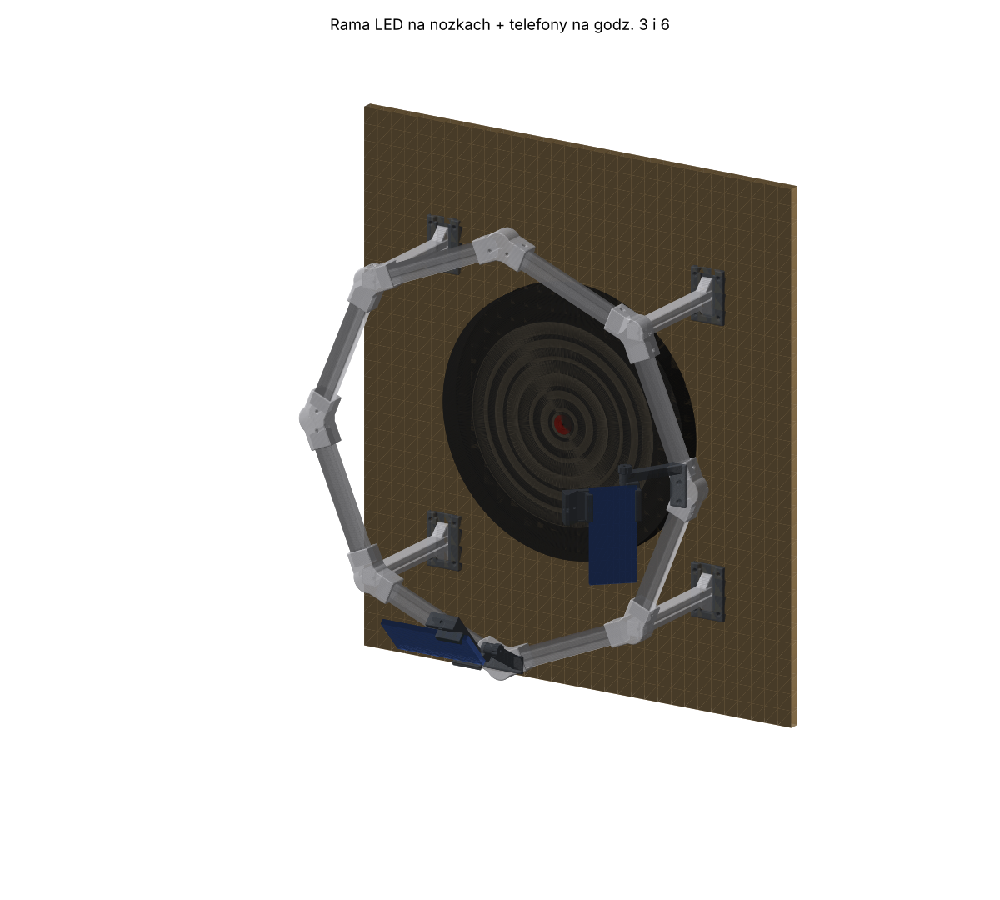
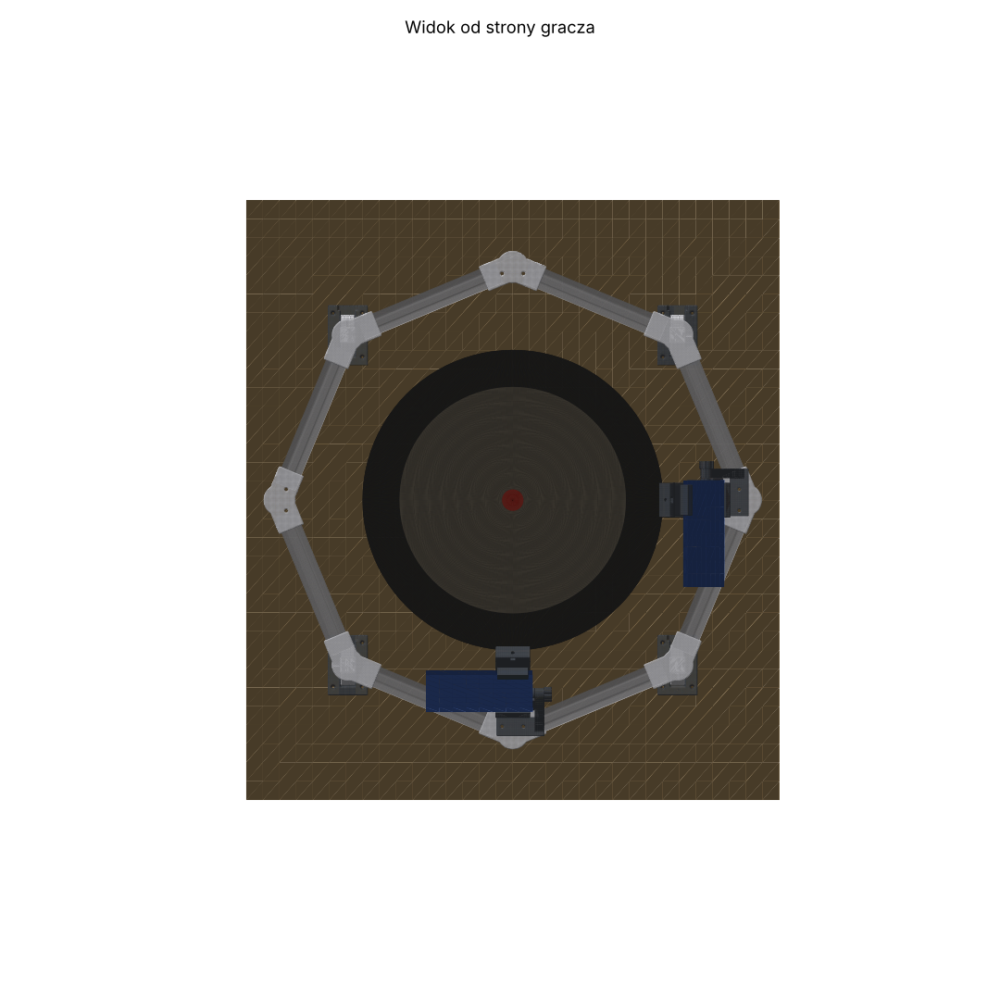
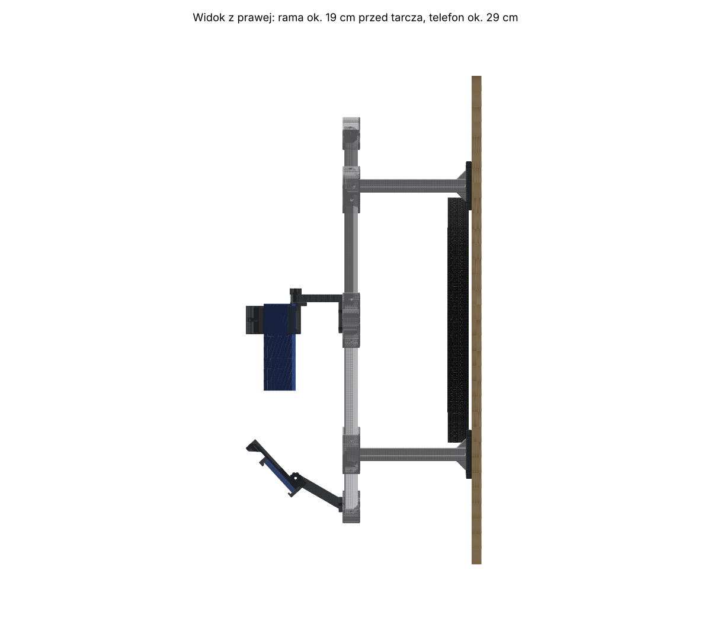
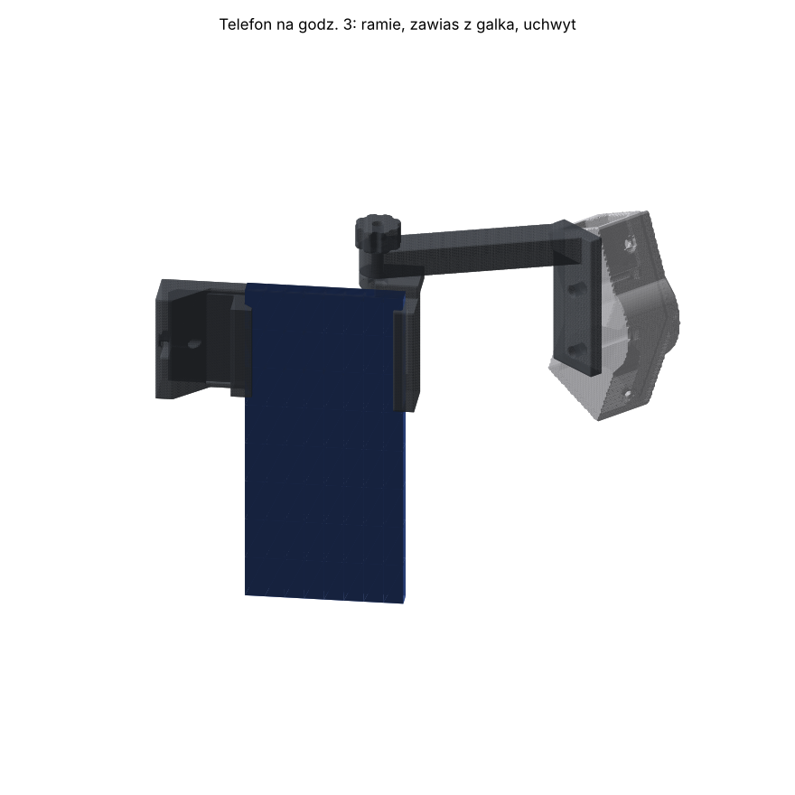

# Oko Tarczy: rama LED na nóżkach i uchwyty na telefony (druk 3D)

Ośmiokątna rama (ok. 75 cm) stoi na 4 nóżkach. Nóżki wsuwają się w płytki przykręcone do płyty OSB, na której wisi tarcza.
Rama jest ok. 19 cm przed tarczą. Taśma LED siedzi na tylnej stronie belek i świeci w tarczę, a nie w oczy gracza i nie w aparat.

Telefon wisi na ramieniu przy narożniku z prawej strony (godzina 3):
- aparat jest ok. 29 cm przed tarczą i 30 cm w bok od bulla;
- telefon stoi pionowo, aparatem do góry, więc ekran nie jest odwrócony.

Drugi telefon (na później, do trybu dwóch telefonów) idzie na godzinę 6.

**Zdejmowanie:** unieś ramę ok. 8 cm do góry i odciągnij do siebie. Płytki zostają na OSB, a telefon może zostać na ramie.

| Od strony gracza | Z prawej strony |
|---|---|
|  |  |

## Co to da, a czego nie

- **Stałe, równe światło z 8 stron:** mniej ostrych cieni i odbić, wieczorem tak samo jak w dzień.
- **Telefon się nie rusza:** rama jest przykręcona do tej samej płyty co tarcza, więc koniec z drganiem statywu.
- **Większa dokładność:** w kierunku do telefonu ok. 25% więcej pikseli na milimetr niż teraz (ok. 2,3 zamiast 1,85 px/mm w pełnym wideo). W poprzek jest podobnie jak teraz.
- **Miejsce na drugi telefon:** później punkt wbicia będzie liczony z dwóch widoków, bez zgadywania długości grota.
- **Uwaga na zoom:** telefon jest blisko, więc w aplikacji zoom musi być 1× (bez przybliżenia).
  - Pole punktowe z zapasem zajmuje wtedy ok. 90% kadru w jedną stronę i ok. 65% w drugą.
  - Liczyłem dla typowego aparatu głównego (ok. 70° × 43° w wideo).
  - Napisy z numerami po bliższej i dalszej stronie tarczy mogą się nie zmieścić. To nie przeszkadza w liczeniu.

## Części do druku (Zortrax M300 Plus, wszystko bez podpór)

| Plik STL | Ile sztuk | Do czego |
|---|---|---|
| `belka.stl` | 8 | boki ramy, z tyłu rowek na taśmę LED |
| `naroznik_noga.stl` | 4 | narożniki ukośne (1:30, 4:30, 7:30, 10:30) z gniazdem na nóżkę |
| `naroznik_telefon.stl` | 4 | narożniki na 12, 3, 6 i 9 z gniazdami nakrętek pod ramię telefonu |
| `noga.stl` | 4 | nóżki, na dole wypust wsuwany w płytkę |
| `plytka_scienna.stl` | 4 | płytki przykręcane do OSB |
| `ramie_telefonu.stl` | 2 | ramię przykręcane do narożnika (na 1 telefon wystarczy 1) |
| `uchwyt_telefonu.stl` | 2 | telefony 62–88 mm szerokości i do 13 mm grubości (z etui) |
| `szczeka_telefonu.stl` | 2 | przesuwna szczęka uchwytu |
| `galka_M5.stl` | 4 | pokrętła na łby śrub M5 |

Pliki są już obrócone tak, jak mają leżeć na stole:
- belki i narożniki leżą przodem do stołu;
- nóżka stoi pionowo (ok. 23 cm);
- uchwyt telefonu stoi na stałej szczęce.

Nawisy sprawdza skrypt `nawisy.py`. Zostały tylko skosy 45° i krótkie mostki: ok. 17 mm w gniazdach narożników i otwory na śruby.

**Ustawienia w Z-Suite:**
- **Materiał:** Z-PETG albo Z-ULTRAT. Nie PLA, bo taśma LED grzeje się do ok. 40–50°C.
- **Warstwa:** 0,29 mm dla belek, narożników, nóżek i płytek; 0,19 mm dla ramienia, uchwytu, szczęki i gałek.
- **Wypełnienie:** 20–30%; nóżki i ramię 40%.
- **Podpory:** wyłączone.
- **Zużycie:** ok. 1,2 kg filamentu. Belka drukuje się kilka godzin, całość kilkadziesiąt godzin.

Gniazda mają 0,3 mm luzu na stronę. Jeśli belka albo nóżka wchodzi za ciasno, przeszlifuj jej koniec papierem ściernym.

## Lista zakupów

- **Taśma LED COB 24 V, 10 mm:**
  - neutralna biel 4000–5000 K, CRI 90 lub więcej;
  - 2 m (potrzeba ok. 1,2–1,4 m: na każdej belce odcinek ok. 15–17 cm).
- **Zasilacz 24 V, co najmniej 1,5 A**, z wtykiem 5,5/2,1 mm:
  - do tego gniazdo DC z zaciskami śrubowymi;
  - nie bierz taniego ściemniacza, bo migotanie przeszkadza kamerze.
- **Przewód 2×0,35 mm²:** ok. 3 m (połączenia między odcinkami taśmy i do zasilacza).
- **Śruby M5 (na 2 telefony; na 1 telefon połowa):**
  - M5×40: 4 szt. (ramię do narożnika);
  - M5×25: 2 szt. (zawias uchwytu);
  - M5×50: 2 szt. (dociskanie szczęki);
  - nakrętki M5: 8 szt.
- **Wkręty 3,5×20 albo 3,5×25 do drewna lub plastiku:** 20 szt. (16 do belek, 4 do nóżek).
- **Wkręty do drewna 4×25 z łbem stożkowym:** 16 szt. (płytki do OSB). Jeśli OSB ma 18 mm, nie bierz dłuższych.

## Montaż

1. **Nakrętki.** Wciśnij nakrętki M5 w sześciokątne gniazda:
   - w narożniku na godzinie 3: od tyłu, 2 sztuki;
   - w uchwycie telefonu: w uchu zawiasu (od spodu płyty) i w bloku śruby (od góry).
2. **Gałki.** Łby śrub M5×25 i M5×50 wciśnij w sześciokątne gniazda gałek.
3. **Nóżki.** Wsuń nóżkę od tyłu w kwadratowe gniazdo narożnika z nóżką i przykręć wkrętem z boku narożnika.
4. **Rama.** Złóż ośmiokąt:
   - narożniki z nóżkami na ukosach (1:30, 4:30, 7:30, 10:30), a narożniki telefonu na 12, 3, 6 i 9;
   - przody narożników są płaskie, rowek na taśmę i fazy belek są z tyłu (od strony tarczy);
   - każdą belkę przykręć w obu narożnikach wkrętem od zewnątrz.
5. **Taśma LED.**
   - Przyklej odcinek taśmy w rowek na tylnej stronie każdej belki, między narożnikami.
   - Połącz odcinki przewodem, + do +. Przewód prowadź po fazie belki i rowkiem na tylnej stronie narożnika.
   - Zasilanie poprowadź rowkiem w jednej z dolnych nóżek do gniazda DC.
6. **Płytki na OSB.** Najlepiej we dwie osoby:
   - Nasuń płytki na wypusty nóżek, szerszym wejściem rowka do góry.
   - Przyłóż ramę do OSB tak, żeby tarcza była na środku: odstęp od brzegu tarczy do belek ma być taki sam dookoła.
   - Przykręć płytki do OSB (4 wkręty w każdej, obok nóżki).
   - Środki płytek wypadają ok. 24,7 cm w bok i 24,7 cm w górę lub w dół od bulla. Przy tarczy na środku płyty 80×90 cm wszystko się mieści.
7. **Ramię telefonu.** Przykręć ramię płaską podstawą do przodu narożnika na godzinie 3: 2 śruby M5×40 w nakrętki od tyłu.
8. **Uchwyt telefonu.**
   - Wkręć śrubę M5×50 z gałką przez blok uchwytu i włóż szczękę w kanał.
   - Przyłóż ucho uchwytu do ucha ramienia i skręć śrubą M5×25 z gałką.
   - Włóż telefon plecami do płyty uchwytu, ekranem do siebie, górą w stronę zawiasu. Aparat ma trafić w okienko przy stałej szczęce.
   - Dosuń szczękę gałką.
   
9. **Ustawienie.**
   - W aplikacji ustaw zoom 1×.
   - Pochyl telefon na zawiasie tak, żeby cała tarcza była w kadrze, a bull mniej więcej na środku, i dokręć gałkę.
   - Skalibruj tarczę od nowa.

## Gdzie stawiać telefony

- **Pierwszy telefon:** godzina 3, z prawej strony, tak jak teraz. Obraz wygląda podobnie jak ze statywu, tylko z bliska.
- **Drugi telefon (na później):** godzina 6, telefon leży poziomo. Dwa widoki przecinają się wtedy pod kątem prostym.
  - Na godzinie 12 nie, bo rzutki lecące w górę tarczy (20, D20) nadlatują od dołu i mogłyby trafić w telefon.
  - Na godzinie 9 nie: ten widok jest z tej samej osi co pierwszy i prawie nic nie wnosi. Do tego telefon byłby tam do góry nogami.

## Uwagi

- Rzutka, która chybi tarczę o więcej niż ok. 8 cm, może trafić w belkę. Z-PETG to wytrzyma, ale zostaną ślady.
- Uchwyt telefonu jest poza torem rzutek. Wyjątek: rzut, który chybi podwójną z prawej i leci mocno z boku, może zahaczyć o blok śruby uchwytu.
- Założyłem, że przód tarczy jest ok. 4,4 cm przed płytą OSB (`Z_OSB` w `rama.py`). Jeśli jest inaczej, rama będzie o tyle bliżej albo dalej. Pochylenie telefonu to wyrówna.

## Pliki i zmiany wymiarów

| Plik | Co robi |
|---|---|
| `rama.py` | belki, narożniki, nóżki, płytki, ramię telefonu (wymiary na górze pliku) |
| `uchwyty.py` | uchwyt telefonu, szczęka, gałka |
| `poza.py` | gdzie jest aparat, co widzi i gdzie ma być zawias (`python3 poza.py`) |
| `sprawdz.py` | kolizje części, kadr aparatu, zasłanianie tarczy, tory rzutek |
| `build.py` | pliki STL w ułożeniu do druku: `python3 build.py katalog` |
| `nawisy.py` | nawisy w plikach STL: `python3 nawisy.py katalog` |
| `podglad.py` | rendery do katalogu `podglad/` |

Po zmianie położenia aparatu (`CAM_TARGET` w `poza.py`):
1. `python3 poza.py` poda nowe położenie zawiasu. Wpisz je do `HINGE_U` i `HINGE_Z` w `rama.py`.
2. `python3 sprawdz.py` sprawdzi kolizje, kadr i zasłanianie.
